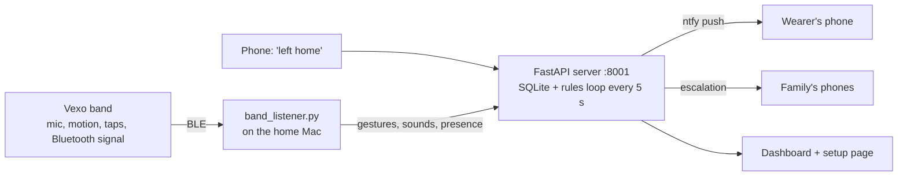

# Memory Band

**A proactive memory assistant for older adults, built on the Vexo Open band.** Built at VexoHacks 2026 (YC, San Francisco).

> 🎥 **Demo video:** _link coming soon_

## The problem

People with early memory loss forget the small things that matter: locking the front door, taking the morning pill (or taking it twice), leaving the phone on a table, leaving the stove on. Families worry and keep calling to check. Most reminder apps only work if you remember to use the app, which doesn't help someone who is forgetting.

## What Memory Band does

The band on the wrist notices these actions **passively**. The wearer never has to say "I locked the door" or press a button. When something gets missed, a push notification goes to the wearer's phone. If it still isn't fixed, the family gets one too. When the band notices the fix, the alert closes by itself and a ✅ follow-up goes out.

| Use case | How the band knows | What happens |
|---|---|---|
| **Forgot to lock the door** | The phone leaving home, or the band's Bluetooth signal fading, means you left. A key-turn twist of the wrist means you locked up. | No key turn → "You didn't lock the door" within ~30 s. Turn the key → ✅ "Front door locked, thanks!" |
| **Pills** | Pill-bottle rattle (mic) plus cap twist or hand to mouth (motion) | Reminder at dose time, a follow-up if it's missed, a double-dose warning if taken twice, and the family is told after 60 min |
| **Phone left behind** | Phone set down (clack + hand resting), then walking away (step counter) with no pick-up | "Don't forget your phone" within seconds |
| **Fall** | Free-fall on the band | A 30 s countdown, cancelled with a double-tap; otherwise an urgent alert to the family |
| **Stove** | A daily check answered with a double-tap (optional speech: "I turned on the stove") | Alert if it's left on |
| **Double-tap = "yes, I did it"** | Band tap event | Answers the latest question |

Setup is designed for an older person: there's no app to install. A simple browser setup page walks through calibrating your own door lock key turn, pill bottle and phone set-down (3 samples each), then a live "lock the door once" test. Notifications use the free [ntfy](https://ntfy.sh) app, which needs no account.

## How it works



- **Passive detection** (`charles/passive.py`, `charles/sounds.py`): onset detection plus spectral templates for sounds, gyro and accelerometer for twists, wrist height, set-down, pick-up and walking. NumPy only, matched against your own calibration samples.
- **Rules engine** (`charles/memory/rules.py`): every alert goes open → pushed → escalated or resolved, with the time it took to fix.
- **Optional speech** (Deepgram): reminders like "dentist Tuesday at 3", and "where did I put my keys?"

## Run it

Needs Python 3.9+, a Vexo Open band, and the [Vexo Open Kit](https://github.com/VexoAI-Org/vexo-open-kit) cloned next to this repo.

```bash
python3.11 -m venv .venv && source .venv/bin/activate
pip install -r charles/requirements.txt
cp env.example .env          # add BAND_NUMBER (and DEEPGRAM_API_KEY if you want speech); never commit .env

uvicorn charles.main:app --host 0.0.0.0 --port 8001     # server + dashboard
python charles/band_listener.py                          # connects to your band (or --sim to try without one)
```

Then open `http://127.0.0.1:8001/setup` and follow the steps. More detail, including all thresholds, is in [`charles/README.md`](charles/README.md).

## Repo layout

- `charles/`: the full Memory Band app (passive detection, rules, push notifications, setup page, dashboard).
- `Backend/` + `bridge.py`: an alternative speech-first version with on-screen alerts and voice replies.

## Tech

Vexo Open band (BLE), Python, FastAPI, SQLite, NumPy, ntfy, Deepgram (optional).

## Team

Charles (Younghoon) Oh ([@coh11](https://github.com/coh11)) and Mamoune ([@melboukfaoui](https://github.com/melboukfaoui)).
