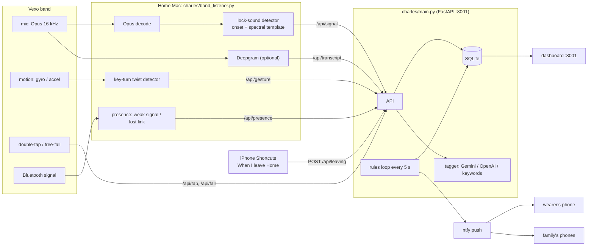

# Memory Band (Charles's version)

**The problem.** Older adults with early memory loss forget things: whether they locked the front door, whether they took the morning pill (or took it twice), the phone left on a restaurant table, the stove left on. Families worry and call to check. Most reminder apps need the person to remember to use the app. That doesn't work for someone who is forgetting.

**What this does.** The Vexo band on the wrist notices these things **passively**, without the wearer saying or pressing anything. Push notifications go to the wearer's phone and, if nothing happens, to the family. The band has no speaker or vibration, so all feedback goes to the phone. A double-tap on the band means "yes, I did it / I'm fine".

This version runs side by side with Mamoune's `Backend/` (port 8000) on **port 8001**. It reads the same `.env` at the repo root and uses the same kit folder, `./vexo-open-kit`.

## What's different here

| | How it works |
|---|---|
| **Passive door check** | When the phone leaves Home (an iPhone Shortcuts automation calls `/api/leaving`), the server checks for evidence of locking in the last 15 minutes. The band's mic counts as evidence when it hears **your lock's click**: you record 3 samples to calibrate it, and matching uses only numpy. The band's IMU counts as evidence when it feels a **key-turn wrist twist** together with a click-ish sound. With no evidence, you get *"You didn't lock the door"* on the phone, and the family gets it after 10 minutes. If the phone automation isn't set up, a fading Bluetooth signal between the band and the home Mac is the fallback, the same idea as the kit's band-leash project. |
| **Phone push notifications** | Through [ntfy](https://ntfy.sh): a free app with no account. There is one topic for the wearer and one for the family. |
| **Double-tap = yes** | Answers the newest question: pill taken, door locked, stove off, "I'm OK" after a fall. |
| **Fall alert** | Free-fall on the band starts a 30-second countdown. A double-tap or saying "I'm fine" cancels it; otherwise the family gets an urgent push. |
| **Pills, passive** | The band notices the pill being taken by itself: the **pill bottle rattle** (mic) together with the **cap twist** or **hand to mouth** (motion) within 30 seconds. A push comes at dose time (09:00 and 21:00 by default); if nothing is noticed, a follow-up comes 30 minutes later and the family is told after 60. Taking it twice gives a double-dose warning. A double-tap still works as "I took it". |
| **Phone left behind, passive** | **Set down** = a clack (mic) + the hand going down and resting (motion). **Walking away** = the band's own step counter (8 steps), or the band's signal fading, or the phone leaving Home. No **pick-up** in between (the hand lifting from where it set the phone down) gives *"Don't forget your phone"* within about 5 seconds of walking off. |
| **Fixes are tracked** | Every alert goes open → push sent → resolved (or escalated). When the band notices the fix (door locked, pill taken, phone picked up), the alert closes by itself, a ✅ follow-up push goes out ("Front door locked at 3:42 PM, thanks!"; to the family too if it had reached them) and the dashboard shows it under **Resolved** with the time it took. |
| **Bathroom, passive** | The mic hears a **toilet flush** (2.5–10 s of steady, noise-like rushing water; voice and short clicks are rejected) with no setup, and the dashboard shows *"Bathroom: N flushes today, last at H:MM"*. **Forgot to flush:** a **toilet paper** rustle followed by walking away (or 15 s) and no flush within another 15 s (demo timing; `bathroom` in config.json) sends the wearer *"Looks like the toilet wasn't flushed"*; a flush closes it with ✅. No flush by 12:00 sends one gentle note to the family. Flushes are never pushed to the wearer. Optional 3-sample calibration of your own toilet and roll on the setup page. Demo without a toilet: the dashboard's 🧻 / 🚽 buttons (`/api/demo/paper`, `/api/demo/flush`). |
| **Drink water, passive** | A **sip** = the band's hand-to-mouth move (wrist up 15 cm+, forearm tilted 30°+, raise of 0.3–4 s) with **no pill-bottle rattle** in the 30 s before (that's a pill); a glass clink within 10 s is noted. One drink per 3 minutes. No drink for 3 hours between 08:00 and 21:00 sends the wearer *"Time for a glass of water 💧"*; a sip or a double-tap closes it with ✅ *"Drink noticed at H:MM, thanks!"*, and the family hears if it stays open 60 minutes. The dashboard shows *"Water: N drinks today"*. Demo: ⏰ / 💧 buttons (`/api/demo/hydration-due?seconds=30` also makes it repeat every 30 s; `/api/demo/drink`). |
| **Stove, passive first** | A daily "is the stove off?" check (18:30) is answered with a double-tap. If speech is on, saying "I turned on the stove" without a later "off" gives an alert after 20 minutes. |
| **Speech (optional extra)** | Deepgram turns speech into sentences, and a tagger handles them (Gemini, then OpenAI, then offline keywords). It covers appointments and promises ("dentist Tuesday at 3", "I'll call Sarah tomorrow") as reminders, people ("this is my neighbor Tom"), and where things are ("I put my keys in the drawer"). Questions are answered on the phone ("where are my keys?"). An item left behind when leaving a place triggers an alert. A question repeated 3 times in 30 minutes sends a gentle note to the family. |

## How it works



## Passive detection (nothing to say)

The listener on the Mac turns the band's mic and motion sensor into actions. Speech is only an optional extra.

| Action | Sound (mic) | Motion (IMU) | Counts when |
|---|---|---|---|
| Door locked | your lock's clack (calibrated) → `lock_sound`; uncalibrated or weak match → `click` | key-turn twist (calibrated or default 70–200°) | `lock_sound` alone, or twist + click within 5 s. A twist alone never counts (ordinary arm moves look like twists) |
| Pill taken | pill bottle rattle → `pill_rattle` (many little clicks in 1 s) | cap twist (40°+) or hand to mouth (wrist up 15 cm+ with 30°+ forearm tilt) | rattle + at least one motion cue within 30 s. Repeats within 60 s are the same dose (closing the cap) |
| Phone set down | clack → `setdown_clack` (calibrated) or `impact` (short sound that dies fast) | hand goes down 6 cm+ and rests | sound + motion within 4 s → `item_placed` (phone) |
| Phone picked up | — | hand lifts from the pose it set the phone down in, and no walking starts in the next 4 s (that would be standing up) | → `item_picked_up`, resolves the alert |
| Toilet flushed | 2.5–10 s steady broadband noise → `toilet_flush` (or matches your calibrated flush); refill hiss ignored; once per 60 s | — | counted per day; resolves "forgot to flush" and the midday check |
| Toilet paper used | 0.4–3 s bright, noise-like rustle → `toilet_paper` (or your calibrated roll) | walking (step counter) ends the bathroom visit early | no `toilet_flush` within the grace time → "Looks like the toilet wasn't flushed" |
| Drank water | glass clink (`impact` / `setdown_clack`) within 10 s, optional | hand to mouth, raise 0.3–4 s | no `pill_rattle` in the last 30 s → `drink_noticed` (once per 3 min); resolves the water reminder |
| Walking away | — | the band's `activity` stream: 8 steps within 12 s (or walk state for 4 s); accelerometer step counter if no activity readings | with an un-picked phone → `leaving_place` → "Don't forget your phone" |

How: sounds use an onset detector plus a 24-band spectrogram (one clack) or a 1-second texture (average spectrum + click count, for the rattle), matched by cosine similarity against your 3 samples. Numpy only. Up/down movement comes from gravity (which way is up in the band's axes), turned with the gyro during the move and integrated twice, with the speed forced to zero when the wrist rests again. All thresholds are in `memory/config.json` under `passive` (`sounds`, `twist`, `cap_twist`, `motion`, `gestures`, `walk`, `calibration`), `pills.passive` and `items.passive`. YAMNet was not added: it has no "pill bottle" or "phone on a table" class, and a model download plus a runtime would add setup risk for little gain over your own 3 samples.

### Calibrate (once, ~3 minutes)

Easiest: open **http://127.0.0.1:8001/setup** (or `http://<Mac's IP>:8001/setup` on a phone on the same Wi-Fi) while the listener runs. One step per screen: door lock sound, key turn, pill bottle, phone set-down, 3 times each, with Skip / use default and Redo, then a live "lock the door once" test. Or from the command line (stop the running listener first):

```bash
.venv/bin/python charles/band_listener.py --calibrate-sound lock      # lock the door 3x (= --calibrate-lock)
.venv/bin/python charles/band_listener.py --calibrate-twist           # turn the key 3x
.venv/bin/python charles/band_listener.py --calibrate-sound pill      # shake out a pill 3x
.venv/bin/python charles/band_listener.py --calibrate-sound setdown   # put the phone on the table 3x
```

Samples are saved in `charles/memory/data/` (`sound_lock.json`, `sound_pill.json`, `sound_setdown.json`, `lock_twist.json`). The band's light can't be used for feedback here: while the mic is on, the kit locks the LED to solid blue, so the page shows the progress.

### Tuning at the venue

`.venv/bin/python charles/band_listener.py --debug-sensors` prints every sound onset with its score for each action (lock / pill / setdown), its click count, brightness and how fast it dies away, plus every move (`lower` / `raise`, metres, tilt), every twist and, twice a second, gyro speed, |a|, tilt from rest, steps and walking. Raise `match_score` if other sounds match, lower it if yours are missed.

Door rule: the person leaves home (phone, or band signal as the fallback). If there was no `door_locked` in the 15 minutes before, the wearer gets a push about 15–20 seconds later (`door.grace_minutes`, demo setting) and the family 10 minutes after that. `door_locked` comes from a lock-sound match, a twist plus a click within 5 seconds, a double-tap answer, or speech ("I locked the door").

## Setup (Mac, from the repo root)

```bash
# once
git clone https://github.com/VexoAI-Org/vexo-open-kit.git      # kit at ./vexo-open-kit (gitignored)
python3.11 -m venv .venv                                        # skip if .venv already exists
.venv/bin/pip install -r charles/requirements.txt
```

Add these lines to the **repo-root `.env`** (see `charles/.env.example`; never commit it):

```
BAND_NUMBER=<number on your band's bag>
MEMORY_TOKEN=<any long random string>      # protects the phone webhook
# DEEPGRAM_API_KEY / GEMINI_API_KEY / OPENAI_API_KEY are optional extras
```

## Run

```bash
# 1. server + dashboard (http://127.0.0.1:8001)
.venv/bin/uvicorn charles.main:app --port 8001

# 2. band (double-tap the band first; close the kit dashboard: one connection at a time)
.venv/bin/python charles/band_listener.py            # uses BAND_NUMBER, or pass the number

# calibrate once at your own door (band on the wrist you lock with)
.venv/bin/python charles/band_listener.py --calibrate-lock     # lock the door 3x
.venv/bin/python charles/band_listener.py --calibrate-twist    # turn the key 3x
```

Listener options: `--debug-sensors`, `--speech on|off|auto` (default auto = on if `DEEPGRAM_API_KEY` is set), `--no-mic` (twist alone then counts as locked; no sounds), `--pill-shake`, `--door-sound`, `--usb`.

## End-to-end demo: forgot to lock → push → locked → resolved

1. Terminal 1: `.venv/bin/uvicorn charles.main:app --port 8001`. Terminal 2: double-tap the band, then `.venv/bin/python charles/band_listener.py`.
2. Phone: ntfy app subscribed to the wearer topic (shown at the bottom of the dashboard).
3. Dashboard → **Demo mode**: **Reset** → **Open setup** (calibrate the lock, or skip if done) → **Next** → **Leave home** (the same call the phone's geofence makes, `/api/leaving`).
4. About 20 seconds later *"You didn't lock the door"* arrives on the phone; the demo card shows "Push sent".
5. Lock the door with the band on (or turn the key and make it click). The alert closes by itself, *"Front door locked at 3:42 PM, thanks! (40 s after the alert)"* arrives, and the dashboard shows it under **Resolved** with "fixed in 40 s". **Run again** repeats from step 3.

Then the other two, no buttons needed:

- **Phone left behind:** put the phone on the table (wrist down, clack). Stand up and walk ~10 steps: *"Don't forget your phone"* within about 5 s of walking. Go back, pause, lift the phone: ✅ *"You picked up your phone"*. (Pick it up, wait 4 s, then walk: no push.)
- **Pill:** set the demo clock past a dose (`curl -X POST localhost:8001/api/clock -H 'content-type: application/json' -d '{"time":"09:35"}'`). The pill reminder arrives. Open the bottle (twist), shake out a pill (rattle), hand to mouth: ✅ *"Pill taken"*. Do it again more than 60 s later: *"Possible double dose"* to wearer and family. Reset the clock with `-d '{"reset":true}'`.

No band? `.venv/bin/python charles/band_listener.py --sim` (pretend band) and act with `curl -X POST localhost:8001/api/sim/act -H 'content-type: application/json' -d '{"action":"@lock-sound"}'` (also `@twist`, `@pill`, `@set-down`, `@walk`, `@stop`, `@pickup`). Or play scripts: `charles/replay.py charles/demo_passive.txt` (server only) and `band_listener.py --sim --script charles/demo_band_passive.txt` (real listener code). Offline detector checks: `.venv/bin/python charles/test_passive.py`.

### Phone notifications (2 minutes)

1. Install **ntfy** from the App Store or Play Store.
2. Open the dashboard. At the bottom it shows the two topic names (random and hard to guess, made on first run, or set by `NTFY_USER_TOPIC` / `NTFY_FAMILY_TOPIC`).
3. In ntfy, tap **+**, then subscribe to the wearer topic on the wearer's phone and the family topic on family phones.

### iPhone "left home" automation

The Mac must be reachable from the phone when it leaves Home, and by then the phone is usually off home Wi-Fi. Use a tunnel:

```bash
cloudflared tunnel --url http://localhost:8001      # prints https://<name>.trycloudflare.com
# or: ngrok http 8001                                # prints https://<id>.ngrok-free.app
```

Requests through a tunnel are refused unless they carry `MEMORY_TOKEN`. Requests from the Mac itself are not checked. If you only demo on the same Wi-Fi, run uvicorn with `--host 0.0.0.0` and use `http://<Mac's IP>:8001` instead.

In the **Shortcuts** app:

1. Go to **Automation**, tap **+**, choose **Leave**, pick your Home address, and choose **Run Immediately** (iOS 17+; older iOS asks first).
2. Add the action **Get Contents of URL** with URL `https://<tunnel>/api/leaving?token=<MEMORY_TOKEN>`. Tap ▸ and set **Method: POST**.
3. Repeat with **Arrive** and `.../api/arrived?token=<MEMORY_TOKEN>`.

Test it from a terminal: `curl -X POST "https://<tunnel>/api/leaving?token=<MEMORY_TOKEN>"`.

## Demo with no band

```bash
.venv/bin/uvicorn charles.main:app --port 8001        # terminal 1 (NTFY_DRY_RUN=1 to only print pushes)
.venv/bin/python charles/replay.py                    # terminal 2: a whole day in ~1 minute
```

`replay.py` moves the server's demo clock through `charles/demo_day.txt`: 07:30 to 18:30. Along the way it shows these:

- The stove alert, then a double-tap.
- Lock sound followed by leaving: no alert.
- The 9:00 pill push, the follow-up, escalation to the family, and a double-tap.
- A double-dose warning.
- A repeated question, with a note to the family.
- Appointment and promise reminders.
- "Where are my keys?" answered on the phone.
- Leaving with no lock gives "You didn't lock the door", then a twist plus a click resolves it.
- The phone left on a restaurant table.
- A fall cancelled by double-tap, then a fall with no answer that reaches the family.
- Band signal fading as the fallback for leaving.
- The 18:30 stove check.

Use `--pause 4` for a slower live demo. It wipes data first; use `--keep` to keep it.

To run the real band code path on the kit's pretend band: `.venv/bin/python charles/band_listener.py <band number> --sim --script charles/demo_band.txt`. It covers a fall, double-tap, twist, lock click, phone leave/arrive, and signal fade.

**60-second pitch flow.** Show the dashboard. Run `replay.py --pause 3`. Point at the door alert arriving on the phone, then the twist plus click resolving it. Then show the fall alert reaching the family phone.

## API (all under `/api`; docs at `/docs`)

`POST /leaving` `POST /arrived` (phone) · `POST /presence {state}` · `POST /signal {kind: lock_sound|click|pill_rattle|setdown_clack|impact|door_sound}` · `POST /gesture {kind: lock_twist|cap_twist|to_mouth|set_down|pickup|walking|pill_shake}` · setup page: `POST /calibrate/start|default|cancel {action}`, `GET /calibrate/status`, `POST /calibrate/progress` and `POST /listener/heartbeat` (listener) · demo: `POST /demo/leave`, `POST /demo/arrive`, `POST /sim/act {action}` (pretend band) · `POST /tap {kind}` · `POST /fall` · `POST /transcript {text}` · `POST /ask {question}` · `GET /state` `/events` `/alerts` · `POST /alerts/{id}/ack` · demo only: `POST /clock {time|advance_minutes|reset}` and `POST /reset`.

## Files

```
charles/
  main.py            FastAPI app (port 8001): dashboard at /, API at /api
  memory/            server package: api.py (routes), rules.py (proactive rules + escalation),
                     service.py (events, answers), tagger.py (Gemini/OpenAI/keywords), store.py (SQLite),
                     notify.py (ntfy), clock.py (demo clock), config.json (times, thresholds),
                     static/index.html (dashboard), data/ (db, topics, calibration; gitignored)
  band_listener.py   band -> server: sounds, twists, moves, walking, presence, double-tap, fall,
                     calibration (setup page or CLI), --debug-sensors, optional speech
  sounds.py          calibrated sounds: lock / pill rattle / phone set-down (numpy) + synthetic sounds
  passive.py         twist, up/down moves, gestures (set-down, pick-up, hand to mouth), walking, presence
  lock_sound.py      shared spectrogram features + the older lock-only detector
  memory/static/setup.html   phone-friendly calibration page (/setup)
  test_passive.py    offline detector checks with synthetic signals
  replay.py, demo_day.txt, demo_passive.txt, demo_band.txt, demo_band_passive.txt   demo without a band
```

## Limits (honest)

- **Passive pill / phone / pick-up are heuristics, untested on a real band.** Keys jangling can sound like a pill bottle; a cup set down can sound like a phone. Calibrating with your own bottle and phone helps. Standing up from the table looks like a pick-up, so a pick-up only counts if no walking starts within 4 s: pick up the phone and walk off right away and you may get a "did you forget" push anyway. Resting the hand back on the table and lifting it can count as a pick-up. The wrist must come to rest (briefly still) for a move to be measured.
- **Not tuned on a real band yet.** The thresholds in `memory/config.json` (twist angle, signal dBm, sound scores) are starting guesses tested on the kit's pretend band and on synthetic sounds. Calibrate at your own door.
- **Lock sound.** Other sharp clicks (a cabinet, a dropped spoon) can look similar, so an uncalibrated mic only reports "click-ish", which counts only together with a twist. Street noise, or locking with the hand that isn't wearing the band, makes it harder to hear.
- **The mic stays on** for lock sounds. The band's light is solid blue (the kit locks the LED while the mic is on) and the battery drains faster. Sound is analysed on the Mac and not stored. Speech is sent to Deepgram only when speech is on. Tell people nearby.
- **Away from home** the band is out of Bluetooth range of the Mac, so double-taps can't reach the server. Answer from the phone or dashboard instead. When you're back, the listener reconnects by itself within 2 minutes; after longer, double-tap the band.
- **ntfy topics are public by name.** The defaults are random. For real use, run your own ntfy server or use access tokens.
- Not a medical device; reminders only.
